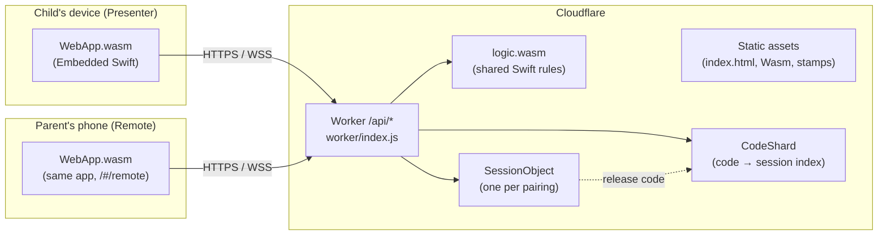
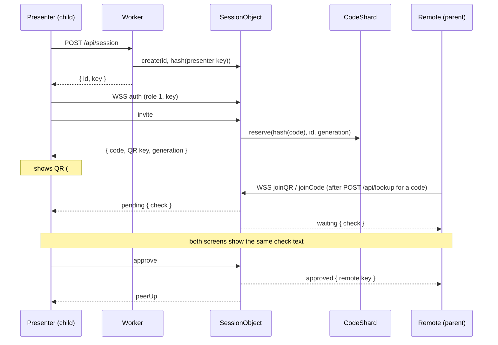

# Architecture

SpeedMath is a flash-card app for first graders, written in Swift and compiled to WebAssembly.
It runs entirely in the browser for solo play. An optional remote control lets a parent drive a
game on the child's device from their own phone, through a small Cloudflare Worker.

- Production: https://speedmath.ainame-apps.workers.dev (Cloudflare Worker `speedmath`)
- Staging: https://speedmath-staging.ainame-apps.workers.dev (Worker `speedmath-staging`)
- The old GitHub Pages site (https://ainame.github.io/SpeedMath/) still serves its last build but
  is no longer updated.

## Components

| Piece | Where | Language |
| --- | --- | --- |
| The app (both roles) | `Sources/WebApp`, `index.html`, `styles.css` | Swift (Embedded Wasm), CSS |
| Shared pure models and rules | `Sources/ProtocolModels`, `Sources/SessionLogic` | Swift, no Foundation |
| Browser API bindings and wrappers | `Sources/BrowserAPI` | Swift + BridgeJS |
| Remote message codec | `Sources/RemoteProtocol` | Swift |
| Wasm start-up and QR library injection | `web/main.js` | JS |
| Worker and Durable Objects | `worker/` (`index.js`, `session-object.js`, `code-shard.js`, `shared.js`, `protocol.js`) | JS (see [decision 0001](decisions/0001-worker-without-async-await.md)) |
| Integer rules for the Worker | `Sources/Worker/Exports.swift` → `worker/generated/logic.wasm` | Swift, freestanding, no imports |
| Build and deploy config | `cloudflare.config.ts`, `vite.config.ts`, `.github/workflows/deploy.yml` | TS / YAML |

### Swift targets (`Package.swift`)

- **ProtocolModels**: wire types and checks shared by every side. `Wire.swift` holds only
  integers and enums (`WireRules`, `Role.canRelay`, `Screen`, `RemoteAction`, `Command`) so it can
  also be compiled into the heap-free `logic.wasm`. `Validation.swift` adds string checks, code
  normalization and `Snapshot`/`WireCard` for the browser.
- **SessionLogic**: decks and card ranges (`Deck.swift`), the play reducer (`PlayState`), and the
  Presenter's `CommandLedger` (version counter and duplicate-command handling).
- **BrowserAPI**: every browser API the app uses, as typed BridgeJS bindings (`WebBindings.swift`,
  generated by the `BridgeJS` build plugin) and the Swift-facing wrappers built on them
  (`BrowserServices.swift`: `BrowserSocket`, `BrowserHTTP`, `BrowserPage`, `Timeout`,
  `RepeatingTimer`). JS exceptions surface as Swift errors (`throws(JSException)`), so no JS
  `try/catch` bridges are needed. The QR library is the one import injected from `web/main.js`
  (`getImports`); `index.html` has no inline script.
- **RemoteProtocol**: the remote message codec (`RemoteWire.swift`: `ServerMessage` /
  `ClientMessage`).
- **WebApp**: the executable: views, routing, storage, and the remote control (`RemoteLink`,
  `RemoteHub`, `RemoteViews`). `RemoteLink` is protocol logic only and does not import
  JavaScriptKit.
- `Sources/Worker/Exports.swift` is not an SPM target. `Scripts/build-worker-wasm.sh` compiles it
  with `Wire.swift` into `logic.wasm` (under 1 KB, no imports).

## The app

- `App.swift`: `AppRoot` owns app-wide state above the router: `PlaySettings`, `StampBook`,
  `TodayRecords` and `RemoteHub`. `RemoteLink.startup()` runs before the first render to take a QR
  invite out of the URL and restore a reloaded Presenter.
- `AppRoutes.swift`: hash routes `/`, `/play/:deck?count&timer&zero`, `/remote`, `/stamps`,
  `/records`. Hash mode is deliberate: QR invites travel in the fragment (`#/remote?invite=…`),
  which browsers never send to the server, and the app needs no link-interception script.
- `AppShell.swift`: header (home-screen-only リモコン button / 「リモコン ✓」 indicator) and the
  pairing panel overlay.
- One file per screen: `HomePage`, `PlayPage` (ready → playing → finished), `StampsPage`,
  `RecordsPage`, `NotFoundPage`; the Remote's screens are `RemotePage`, the child's pairing panel
  `PairingPanel`.
- Per-day data (stamps, records) lives in localStorage through `DailyStorage`, a small JSON codec
  on `BrowserPage.localValue`, and resets at local midnight.

Solo play needs no network: the play screen shuffles a fixed deck, measures time, and on finish
adds one record and awards one stamp.

## Remote control

### Roles

- **Presenter** (child's device) is the source of truth: it shuffles, keeps the timer, decides
  every state change, and stores records and stamps. `RemoteHub` owns its `RemoteLink` for the
  whole app, so pairing survives moving between screens.
- **Remote** (parent's phone, `/#/remote`) mirrors the Presenter's screen and sends commands.
  It shows answers; the Presenter never renders them.
- While paired, navigation (choosing cards and options, スタート, はじめる, もういちど,
  えらびなおす, やめる) belongs to the parent and is hidden or locked on the child's screen.
  Card taps and arrow keys work on both sides.

### Pairing

- An invite generation lasts 2 minutes; the QR and the typed code belong to the same generation
  and are consumed together on approval. Five wrong attempts end the generation.
- Credentials are random, bound to session and role, and stored only as SHA-256 hashes. Invite
  values travel in request bodies or the first WebSocket message, never in URLs the server sees.
- Every invalid or unknown request gets the same 404 (`{ error: "unavailable" }`).
- Limits: a session lasts at most 2 hours; a disconnected role may reconnect for 10 minutes; one
  Remote per session. Per-client rate limits per minute in production: lookups 5, session creates
  10, connections 45 (staging and local preview allow 4×).

### Sync and commands (protocol v2)

- The Presenter sends `sync` snapshots: `epoch` (this Presenter document), `version`,
  `deckVersion` (this shuffle), `screen` (home / ready / playing / finished), `index`, `elapsed`,
  `cards` as `[lhs, ±1, rhs]`, and the settings (`deck`, `zero`, `count`, `timer`).
- The Remote sends one `command` at a time: `action` (next, previous, start, begin, replay, home,
  deck, zero, count, timer), `value`, `baseVersion` and an `id`. It resends the same id until an
  `ack` arrives.
- `CommandLedger` applies a command only when `baseVersion` matches the current version, answers
  a resent id with its first result, and moves the version on for every change from either side.
  A stale command gets `resync` and the Remote shows that its last action was not confirmed.
- The timer is not streamed: the Remote counts locally from the last snapshot's `elapsed`.
- The Worker relays only well-formed messages in their role's direction (`relayKind` in
  `worker/protocol.js`, using `WireRules` from `logic.wasm`). `WireRules.protocolVersion` is the
  single source of the protocol version for the app, the Worker and `/api/health`.

### Worker and Durable Objects

- `worker/index.js` handles `/api/*` (`assets.runWorkerFirst`); everything else is static assets.
- `SessionObject` (SQLite-backed, one per session) stores one JSON row: credential hashes, expiry,
  socket ids, the current invite and a pending join. It uses hibernatable WebSockets and alarms to
  expire invites, reconnect windows and the session. Cards, answers, times and records never
  reach it.
- `CodeShard` (sharded by the first three hex digits of the code hash) maps a code hash to its
  session and generation until the invite expires.
- Cleanup is idempotent: repeated or late alarms, lookups and reconnects are safe after the
  session is deleted.

## Build, test and deploy

| Step | Command |
| --- | --- |
| Swift unit tests | `swift test` |
| Build (Embedded Swift, Vite, Worker) | `pnpm exec cf build --mode staging` (or `production`) |
| Check the build output | `pnpm exec node Scripts/check-build.mjs staging` |
| Durable Object tests (Node, fake host) | `pnpm run test:worker` |
| Browser tests (local workerd) | `pnpm exec playwright test` |
| Browser tests against staging | `SPEEDMATH_TEST_URL=https://speedmath-staging.ainame-apps.workers.dev pnpm exec playwright test` |
| Idle / redeploy smoke test | `SPEEDMATH_TEST_URL=… pnpm exec node Tests/browser/live-smoke.mjs [--redeploy]` |

Build modes in `cloudflare.config.ts`: `staging`, `production`, and `staging-solo` /
`production-solo`, which keep the Durable Object classes but turn the remote API off (a rollback
path that keeps solo play).

GitHub Actions (`.github/workflows/deploy.yml`) builds and tests everything inside the
`swift:6.4.2` container on pushes to `main`, `staging` and `codex/**` and on pull requests. It
deploys the tested bundle with `cf deploy --prebuilt`: `main` to production
(`CLOUDFLARE_API_TOKEN`), `staging` to staging (`CLOUDFLARE_STAGING_API_TOKEN`). Cloudflare does
not build anything; its dashboard (Workers & Pages → the Worker → Deployments / Logs) shows the
uploaded versions, rollbacks and request logs. Staging may also be deployed from a developer
machine with `pnpm exec cf deploy --prebuilt --mode staging`.

## Related documents

- [decisions/0001-worker-without-async-await.md](decisions/0001-worker-without-async-await.md):
  why the Worker stays in JavaScript; the full Swift Worker is on the `swift-worker` branch.
- `REMOTE-VERIFICATION.md`: what was verified, where, and what is still open.
- `TODO.md`: the original remote-control plan and its checklist.
